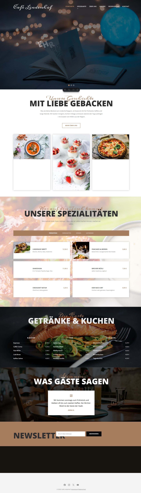
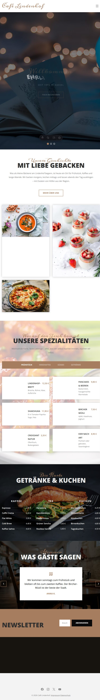
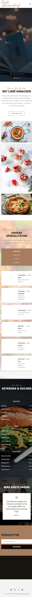
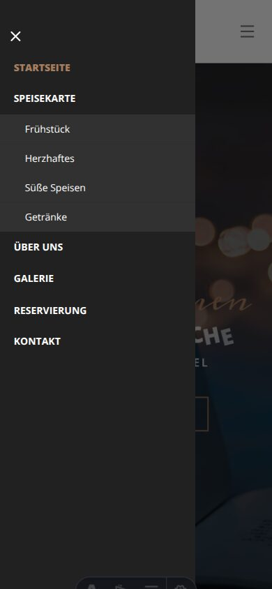
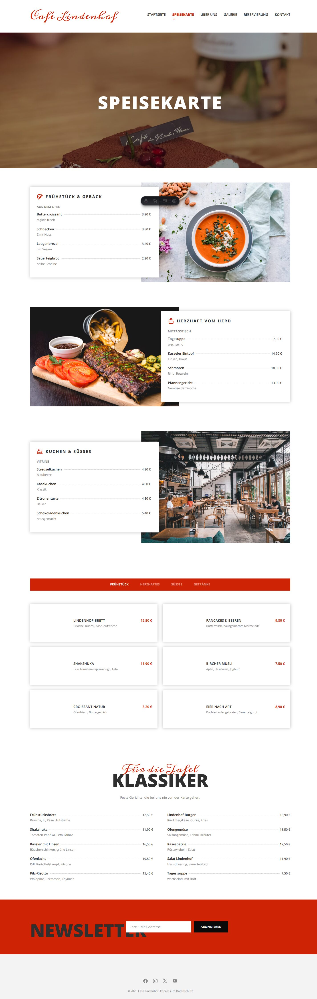
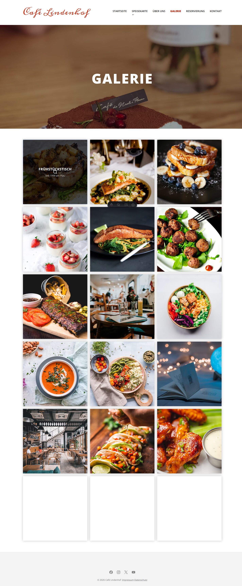
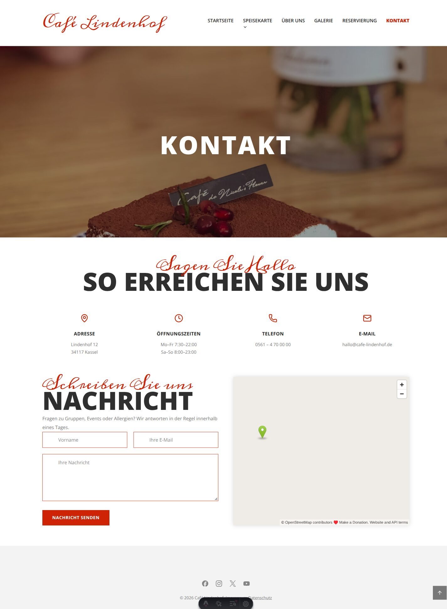
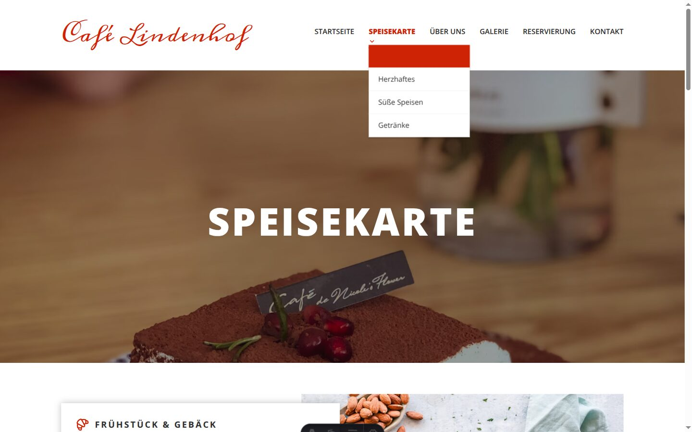
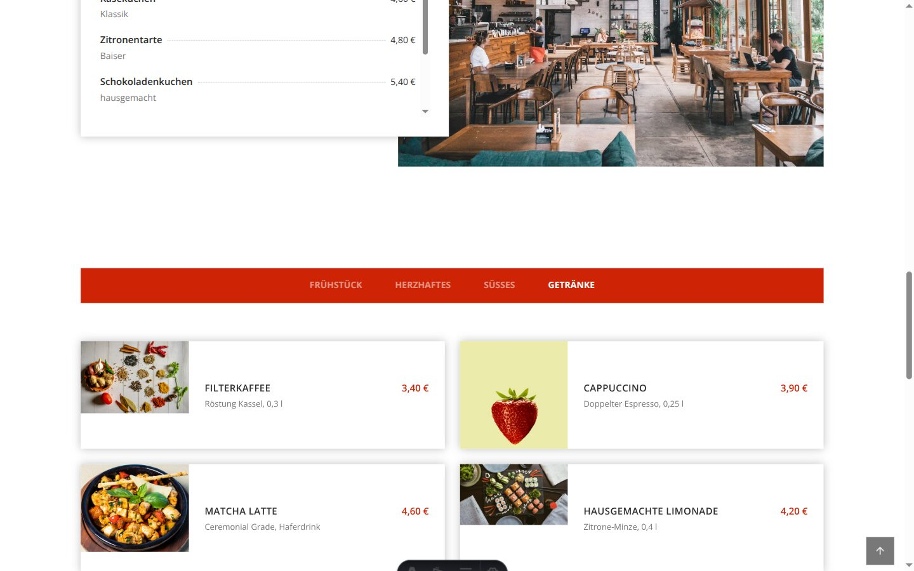

<div align="center">
  

  # Café Lindenhof

  **Kaffee, Kuchen und ein Stück Lindenhof — mitten in Kassel.**

  [](https://astro.build)
  [](https://tailwindcss.com)
  [](https://www.typescriptlang.org/)
  [](https://github.com/Yevhenii1951/cafe-lindenhof)

  

  <em>Übungs-/Lernprojekt — fiktives Café, keine echten Daten, kein Live-Betrieb.</em>
</div>

---

## Überblick

Eine fiktive Café-Website für „Café Lindenhof" in Kassel: statische, mehrseitige
Seite mit Tagesmenü, Galerie, Kontakt und Reservierung. Das Projekt ist als
Lernarbeit entstanden, um eine mehrseitige Web-Vorlage eigenständig in Astro
nachzubauen — Layout, Farbwelt, Typografie und Interaktionen.

**Problem, das ich damit geübt habe:** dieselbe Bildsprache und dieselben
Interaktionen über acht Seiten konsistent halten, ohne ein JS-Framework zu
benutzen.

**Lösung:** statisches Astro-SSG, CSS-Tokens für das Farbsystem, native
Cross-Document-View-Transitions für weiche Seitenwechsel und progressive
Enhancement für Menü, Galerie-Lightbox und Karte.

---

## Funktionen

| Bereich | Beschreibung |
|---------|--------------|
| **8 Seiten** | Start, Speisekarte, Über uns, Galerie, Kontakt, Reservierung, Impressum, Datenschutz |
| **Responsives Layout** | Mobile-first; Header ab `lg` mit voller Navigation, darunter Burger + Drawer |
| **Sanfte Übergänge** | Native View Transitions, Hover-/Wisch-Effekte in der Navigation, Einblenden der Tab-Panels — alle abschaltbar über `prefers-reduced-motion` |
| **Speisekarte mit Tabs** | Kategorien wechseln per Tabs, Panels blenden weich ein |
| **Galerie** | Kachelraster mit eigener Lightbox (ohne Fremd-Library) |
| **Kontakt** | Demo-Formular + OpenStreetMap-Karte, die erst nach ausdrücklicher Zustimmung lädt |
| **Reservierung** | Demo-Formular mit Erfolgsmeldung (rein clientseitig) |
| **Newsletter** | Demo-Anmeldung mit Statusmeldung |
| **Rechtliches** | Impressum und Datenschutz von jeder Seite erreichbar |

---

## Screenshots

### Startseite

<table>
  <tr>
    <td></td>
    <td></td>
  </tr>
  <tr>
    <td></td>
    <td></td>
  </tr>
</table>

### Unterseiten

<table>
  <tr>
    <td></td>
    <td></td>
  </tr>
  <tr>
    <td></td>
    <td></td>
  </tr>
</table>

### Interaktionen

<table>
  <tr>
    <td></td>
    <td></td>
  </tr>
</table>

---

## Tech Stack

| Technologie | Einsatz |
|-------------|---------|
| **Astro 7** | Statische Mehrseiten-Site, Komponenten, `astro check` |
| **Tailwind CSS 4** | Styling über `@tailwindcss/vite`, Design-Tokens über `@theme` |
| **TypeScript** | Strikte Typisierung, geprüft mit `astro check` |
| **@lucide/astro** | UI-Icons |
| **simple-icons** | Brand-Icons |
| **Fontsource** | Meddon (Display) + Open Sans (Text), lokal eingebunden |
| **Native View Transitions** | Seitenwechsel ohne JS-Framework |

Kein Backend, keine Datenbank, kein Fremd-JS (keine React/Vue-Inseln).

---

## Getting Started

### Voraussetzungen

- Node.js 20+
- npm

### Installation

```bash
git clone https://github.com/Yevhenii1951/cafe-lindenhof.git
cd cafe-lindenhof

npm install
npm run dev
```

Die Seite läuft auf [http://localhost:4321](http://localhost:4321).

### Qualitätssicherung

```bash
npm run check    # Astro/TypeScript-Prüfung (0 Fehler erwartet)
npm run build    # Produktions-Build nach dist/
npm run preview  # Build lokal ansehen
```

---

## Projektstruktur

```
├── public/
│   ├── favicon.svg
│   └── for_Readme/            # Screenshots für dieses README
├── src/
│   ├── components/            # Header, Footer, Newsletter, Formulare …
│   │   └── sections/          # Bausteine der Startseite (Hero, Speisen …)
│   ├── layouts/
│   │   └── BaseLayout.astro
│   ├── lib/                   # Bilder, Navigations- und Menüdaten
│   ├── pages/                 # 8 Seiten (Datei-Routing)
│   └── styles/                # global + Komponenten-CSS (getrennt je Bereich)
├── astro.config.mjs
├── package.json
└── tsconfig.json
```

---

## Hinweise zum Demo-Charakter

- **Alle Inhalte sind erfunden.** „Café Lindenhof", Adresse, Telefonnummer und
  Preise existieren nicht; die Seite ist keine Auftragsarbeit.
- **Formulare senden nichts.** Kontakt, Reservierung und Newsletter sind rein
  clientseitige Demos ohne Backend.
- **Die Karte lädt erst nach Zustimmung** (OpenStreetMap-Embed), damit kein
  Drittanbieter ungefragt Daten bekommt.
- **Fotos sind Platzhalter** von Unsplash (freie Lizenz, siehe Fotonachweis auf
  der Impressum-Seite) und dienen nur der Darstellung — nicht als eigene Fotos.
- **Kein Deployment.** Es gibt keine Live-URL.

---

<div align="center">
  <strong>Yevhenii Riabokon</strong><br />
  <a href="https://github.com/Yevhenii1951">@Yevhenii1951</a>
  <br /><br />
  <sub>DCI — Full-Stack Web Development Programm • 2025–2026</sub>
</div>